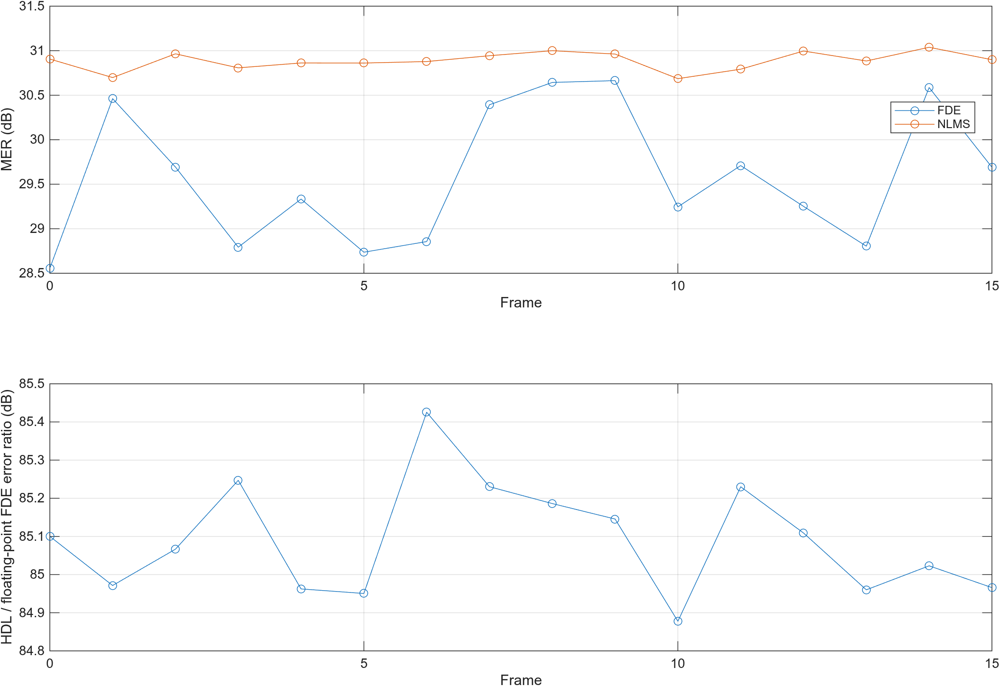

# 随包工程验证记录

以下结果对应本包工程输入与随包数据，测试入口见[使用与复现](../docs/usage.md)。技术文档及演示中的性能结果来自源工程，其作品图表在 [system_examples](system_examples/README.md) 单独列示。

## 1. 功能验证

| 项目 | 范围 | 结果 |
|---|---|---|
| 编解码网表 | 九模式，每模式六块 | 149,940 个编码 bit、112,896 个信息 bit 均匹配；模式/位宽标签正确 |
| Tx RRC 网表 | P=2/4/8，共 252 个并行输出拍及零尾部 | 与 MATLAB 整数卷积逐点一致 |
| 完整接收网表 | 16 个连续 P2/BPSK 帧、96 个 LDPC 块 | 译码前 0/48,960，译码后 0/36,864；控制错误为 0 |
| 均衡与 NLMS | 同一完整接收数据 | 平均 FDE MER 29.588613 dB，NLMS MER 30.886128 dB |
| 浮点均衡对照 | 每帧从实际 FFT 输入独立计算 Mov_ZF | HDL/浮点误差比最小 84.877617 dB；无增益、相位或平移拟合 |
| AI 建议事件 | 本数据集的推荐接口观测 | 记录 12 次事件 |
| PS 软件 | Tx/Rx 各自 XSA，A53 standalone64-bit | 两份 ELF 构建通过，RFDC_PROFILE 分别为 0/1；源码、XSA 和 ELF 关系核验通过 |

条件：RRC span16、实中频 1.2 GHz、ADC 输入 SNR 25 dB、频偏 20 kHz、输入延迟 7 个 ADC 样点与 offset=0。接收数值适用于上述条件；独立编解码测试使用理想 LLR ±63，结果用于比特与接口一致性核对。

完整 [接收输出](rx_link)、[逐帧数值](rx_link/per_frame_metrics.csv)、[MATLAB 记录](rx_link/matlab_verification.json)、[编解码结果](codec/metadata_checks.json) 和 [RRC 结果](rrc/rrc_result.json) 随包保留。复跑方法见 [复现说明](../docs/usage.md)；可先用只读入口核对已记录数据。

## 2. 实现与资源

Tx、Rx 从随包输入建立工程、综合并链接 EDIF，完成实现与 bit/LTX/XSA 导出。输入与实际构建的对应关系见 [input_binding.json](input_binding.json)。完成态工程位于 `../Tx/project/tx.xpr` 和 `../Rx/project/rx.xpr`，具体文件入口见[使用与复现](../docs/usage.md)。

| Routed 项目 | Tx | Rx |
|---|---:|---:|
| LUT | 96,206 | 304,298 |
| FF | 121,972 | 245,015 |
| BRAM36 等效 Tile | 784 | 690.5 |
| DSP | 924 | 2,478 |
| 建立 WNS，ns | +0.059 | +0.048 |
| 保持 WHS，ns | +0.010 | +0.009 |
| 脉宽裕量，ns | +0.455 | +0.455 |
| 总线偏斜最小裕量，ns | +1.623 | +1.708 |

建立、保持、脉宽失败端点数均为 0；Tx 的 23 项、Rx 的 15 项总线偏斜约束全部通过。DRC 的 Error 和 Critical Warning 均为 0，普通 Warning/Advisory 保留在原报告中。

时序结论限于现有 STA 约束。两端各有 2 个 no-clock pin、2 个未约束内部端点；缺失 input/output delay 的端口数分别为 Tx 1/3、Rx 1/4。这些端点保留在原始约束检查中。

- Tx：[层级资源](tx/routed_hierarchy.rpt)、[时序](tx/routed_timing.rpt)、[DRC](tx/routed_drc.rpt)、[总线偏斜](tx/routed_bus_skew.rpt)。
- Rx：[层级资源](rx/routed_hierarchy.rpt)、[时序](rx/routed_timing.rpt)、[DRC](rx/routed_drc.rpt)、[总线偏斜](rx/routed_bus_skew.rpt)。

层级报告深度为 8，独立核综合报告另在 `ip` 中；父子资源不可相加。bit、LTX、XSA 与 ELF 的实际哈希保留在 [Tx 构建记录](tx/build.json)、[Rx 构建记录](rx/build.json) 和 [软件记录](software)。原始 JSON 保留当时构建输出路径；成品工程的交付位置见[使用与复现](../docs/usage.md)，文件对应关系见[交付核对记录](delivery_binding.json)，包含现有 XPR、bit、LTX、XSA、检查点及运行状态。[PS 硬件定义](../software/board/hardware)提供匹配两端的原生 XSA，其中包含本版 bit。工具报告中的数值保持原记录，原始和发布报告的 SHA256 分别记录。

PS 交付整理后，两端还分别在全新目录从随包 XSA 和原应用源码创建平台、BSP 与应用，重新产出实际 ELF；结果见 [PS 交付复核](software/handoff.json)。本项验证未连接板卡。

## 3. 覆盖范围与记录

本包验证范围为九模式编解码、三档 RRC、上述条件下的 P2/BPSK 完整接收，以及两端实现与 PS 软件构建。AI 事件按接口观测数量记录。本次交付核对为离线工程验证；板卡执行状态按原始记录确认。源工程作品测试按 [system_examples](system_examples/README.md) 的来源及条件引用。板卡接入配置见[使用与复现](../docs/usage.md)。

工程、测试与软件输入记录见 [build_inputs.json](build_inputs.json)，实际构建输入对应关系见 [input_binding.json](input_binding.json)，总验证记录见 [validation.json](validation.json)。工程交付文件由 `../MANIFEST.json` 核对。总目录原生 `vitis_workspace/` 的原样复制核对与本页 `software/board` 新工作区构建分别记录。
