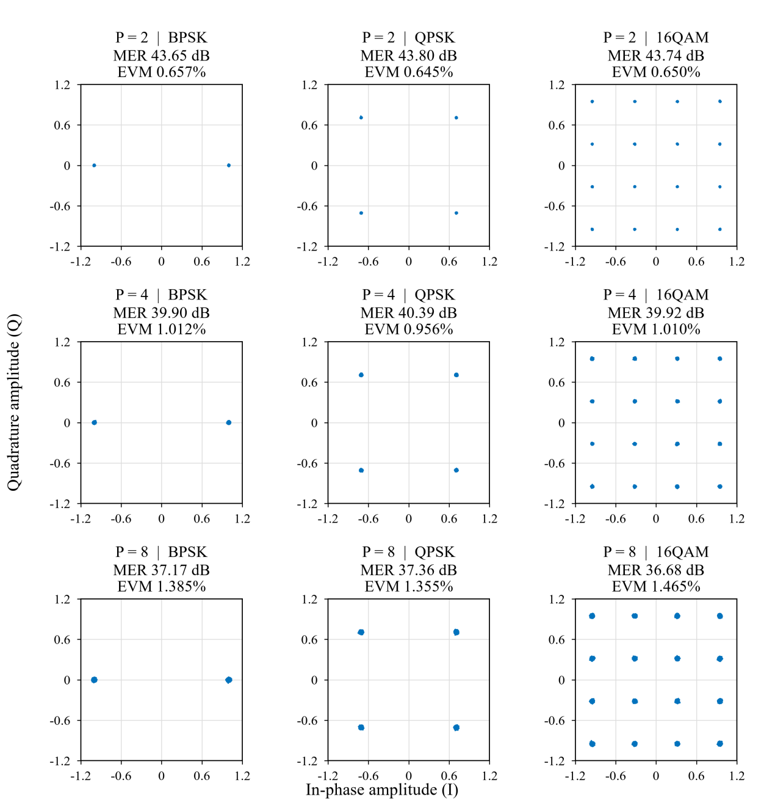

<!-- AdaptiveX publication entry -->
## 完整工程下载

本页提供源码、Skill、技术文档与代码包的浏览入口。已完成综合/实现的 Tx/Rx 工程和原生 Vitis 工作区随本版 Release 提供，下载后保持原相对目录。

[下载本版完整工程](https://github.com/sherlwang/AdaptiveX/releases/tag/preview-855214a315d6)，或在本仓库目录执行：

```bash
python3 skill/sherl-github-project-publish/scripts/receive_submission.py --repo sherlwang/AdaptiveX --tag preview-855214a315d6 --output /path/to/AdaptiveX_Submission
```

输出目录须为空。脚本下载全部附件、核对 SHA-256 并恢复文件。GitHub 自动生成的源码 ZIP 只包含可浏览文件；完整工程使用上述 Release 附件。

---

# AdaptiveX 智能自适应多速率宽带通信系统

基于 AMD RFSoC ZU47DR 的九体制单载波通信工程。采样率为 4.9152 GSPS，支持 P=2/4/8 三档并行度与 BPSK、QPSK、16QAM，Tx、Rx 分别构建。系统包含共享基带、模式识别与帧级切换、以太网业务和星座/误码统计接口。

出于核心技术保护考虑，本次提供部分功能代码；技术文档及演示中的性能结果来自源工程。

## 1. 工程、工作区与 Skill

| 入口 | 内容 |
|:---|:---|
| [AdaptiveX_Prj](AdaptiveX_Prj/README.md) | 已完成综合、实现与 bit 导出的 Tx/Rx 工程，以及源重建输入、仿真和数值检查 |
| `vitis_workspace/` | `SubmissionProjects/vitis_new` 原样复制的 Vitis 工作区 |
| [skill](skill/README.md) | 资源基线、数值对照、源依赖审查、网表交付和发布工具 |
| [协作案例](skill/collaboration.md) | 需求核对、Vitis 可移植性与文件一致性的实际案例 |
| [交付与上传说明](skill/sherl-github-project-publish/references/adaptivex_upload.md) | 工程包、代码 RAR 与后续 GitHub 发布范围 |

使用 Vivado/Vitis 2021.2。直接在 Vivado 中打开：

- Tx：`AdaptiveX_Prj/Tx/project/tx.xpr`
- Rx：`AdaptiveX_Prj/Rx/project/rx.xpr`

保留完整的 `Tx/`、`Rx/` 目录及各自的 `cores/`、`project/` 和配套运行文件。已有 bit、LTX、XSA 的位置、板级启动与可选重建方法见[使用与复现](AdaptiveX_Prj/docs/usage.md)。

Vitis 原生工作区入口为根目录 `vitis_workspace/`；本轮确认其与来源的复制一致性，跨目录构建状态按实际验证记录确认。另提供已在新工作区构建通过的 [PS 源码与构建入口](AdaptiveX_Prj/software/board/README.md)。Skill 可独立使用，不自动安装到个人环境。

在本目录检查工程文件与网表载荷：

```bash
python3 AdaptiveX_Prj/tools/verify_package.py
```

工程清单检查与原生 Vitis 工作区的复制核对分别记录。

## 2. 作品测试展示

下图来自源工程的技术文档，展示九体制基带直连实验中，实采波形经 HDL 接收后的 NLMS 星座。



源工程图表与统计见[作品测试资料](AdaptiveX_Prj/results/system_examples/README.md)。本次随包输入的仿真、数值复核、实现与软件构建记录见[工程验证结果](AdaptiveX_Prj/results/README.md)，各项按实际对象和输入条件列示。

## 3. 本地比赛材料

本地总目录命名为 `AdaptiveX_Submission`，工程、工作区与 Skill 分别放在 `AdaptiveX_Prj/`、`vitis_workspace/` 和 `skill/`。技术文档编辑源及网站上传件平放在根目录：

| 网站入口 | 本地文件 | 页面要求 |
|:---|:---|:---|
| 技术文档 | `technical_report.pdf`；编辑源为 `technical_report.docx` | PDF，50M 内 |
| 演示视频 | `demo.mp4` | H.264，3 分钟内，300M 内 |
| 全部代码 | `adaptivex_code.rar` | RAR，200M 内 |
| 赛事承诺与使用授权书 | `authorization.pdf` | 签字 PDF，50M 内 |
| 作品全貌图 | `overview.png` 或页面允许的图片格式 | 以页面图片提示为准 |
| 作品海报 | `poster.pdf` | 选填；PDF/PPT，50M 内 |

该表是材料索引，文件准备状态以根目录实际内容为准。代码 RAR 从同版工程的源输入、必要依赖、Skill、README 和许可证提取，所选代码与工程包中的对应文件保持字节一致；Tx/Rx 生成运行目录与 IDE 缓存不进入代码 RAR。使用代码 RAR 时按源重建入口操作；完成态 XPR 路径对应完整工程包。

GitHub 使用 `sherlwang/AdaptiveX`：工程源输入、Skill、代码 RAR、技术文档和作品/开发板图片可直接浏览；完整工程和 Vitis 工作区由同仓库 Release 提供。演示视频、授权书、poster 和内部交接说明不上传。使用[发布 Skill](skill/sherl-github-project-publish/SKILL.md)可一次完成上传及文件核验，比赛网站仍按各入口分别提交。

## 4. 许可

本项目自有的工程集成、逻辑表示、脚本、Skill 和说明采用 [MIT License](LICENSE)，版权归各自作者。

第三方代码、IP、模型及工具生成部分沿用其原有条款；MIT 不替代这些条款，也不授予 EDA 工具或厂商 IP 使用权。适用文件与原始条款见[第三方索引](AdaptiveX_Prj/THIRD_PARTY_NOTICES.md)。赛事签字授权书与本项目开源许可证分别使用。
